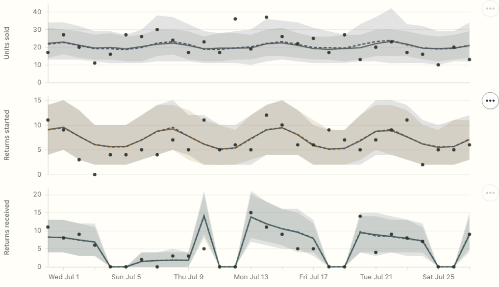

This post is a [marimo](https://marimo.io) notebook with its own layout, so it lives on its own page.

<a href="returns-forecasting.html" style="display:block; margin: 1.5rem 0;">

</a>

**[Read the post &rarr;](returns-forecasting.html)**

Warehouse receipts depend on the returns customers start this week, which depend on what sold last month and what sells this month. The post treats that as a chain of forecasts and builds it on [numpyro_forecast](https://github.com/juanitorduz/numpyro_forecast): sales is an ordinary numpyro_forecast model written with `Horizon` and `predict`, and each return stage is a time-to-event model that speaks the same protocol. One forecast call then carries sales and weather uncertainty through the whole chain, draw by draw.

The chain is scored on four held-out weeks against four baselines: a weekday average, a settled and a naive return rate times lagged sales, and a SARIMAX with lagged sales and return initiations. It lands within 2% of the month, and its daily error is 44% lower than the best baseline's.

The sales step is replaceable. The post fits a second, drifting local-level numpyro_forecast model and propagates its forecast through the already fitted return stages. Fitting a replacement model and overriding future scenarios are separate operations: the return stages do not need to be refitted for either forecast scenario.

The storm scenarios on the page run in your browser: switch between no storm, the storm as forecast, and one that lingers. The sliders and the baseline picker need Python, so on this page they show their defaults; run the notebook to use them.

[ttenet](https://github.com/kylejcaron/ttenet) is the small demo package that wires the stages together: a reference implementation of the idea, meant to be read, run and adapted rather than a maintained library. The notebook behind the page is [`examples/retail_returns_blog.py`](https://github.com/kylejcaron/ttenet/blob/cd40c661a4310888c9cf9eaf6907b67e074ddae3/examples/retail_returns_blog.py). Running it refits the model and recomputes every figure:

```bash
git clone https://github.com/kylejcaron/ttenet && cd ttenet
git checkout cd40c661a4310888c9cf9eaf6907b67e074ddae3
uv sync --python 3.13 --all-extras   # JAX has no Python 3.15 wheels yet
uv run marimo run examples/retail_returns_blog.py
```
